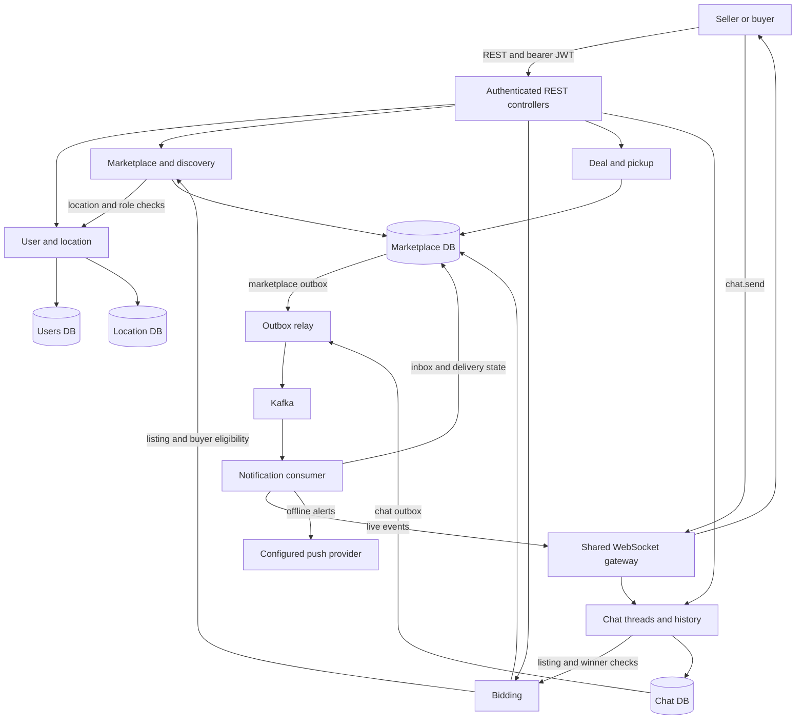

# TolMol backend — how it works and how we got here

**Handoff for another chat working in this repository.** TolMol is a local scrap marketplace. A seller lists a lot, nearby buyers bid per kilogram, and the winning buyer inspects the lot at pickup. The backend carries the transaction through agreement, completion, or cancellation and relisting. The mobile client is a future consumer of the backend.

| Reference | Where to look |
|---|---|
| Worktree | `C:\Users\Admin\Desktop\TolMol`, branch `main` |
| Reviewed snapshot | [Repository at 8ae067f](https://github.com/Siuuuddddd/TolMol/tree/8ae067f). The last implementation commit was `ecc1de9`; `8ae067f` refreshed the handoff. |
| Product rules | [docs/PRD.md](https://github.com/Siuuuddddd/TolMol/blob/8ae067f/docs/PRD.md) |
| Reasons behind implementation choices | [docs/DECISIONS.md](https://github.com/Siuuuddddd/TolMol/blob/8ae067f/docs/DECISIONS.md) |
| Run commands, endpoints, payloads, deployment | [README.md](https://github.com/Siuuuddddd/TolMol/blob/8ae067f/README.md) |
| Feature inventory and manual checks | [Backend handoff](../BACKEND-HANDOFF.md) |

## Start with one sale

This example comes from the buyer and seller simulations in the conversation. The amounts and people are illustrative. **Leading an auction and winning it are separate decisions.**

1. **Meera publishes a lot.** She registers, signs in, sets her seller location, and lists 20 kg of paper at an opening rate of ₹15/kg with an 18:00 deadline. Marketplace copies her pickup coordinates onto the listing. If she later moves, the lot stays at its published pickup point.
2. **Asha discovers it.** Her buyer location must be at most 15 minutes old. Discovery uses Redis GEO to find candidates, then checks the actual 20 km distance, deadline and status. The feed omits exact pickup coordinates. Asha can watch the lot or start a private conversation before bidding.
3. **Two offers arrive.** Asha offers ₹18/kg at 10:00. Ravi offers ₹20/kg at 10:05. The Bidding service validates each REST command against PostgreSQL. Ravi now leads. Asha can bid on a different seller immediately, but her next bid on **any** of Meera’s lots is eligible only at 16:00. Rejections leave the cooldown unchanged.
4. **Meera chooses.** In separate chats, Asha offers to collect today and Ravi tomorrow. Meera can select Asha’s recorded ₹18/kg bid even though Ravi leads. She cannot enter a new lower bid on Asha’s behalf. If Meera waits until 18:00 and no higher offer arrives, Ravi wins automatically. An auction with no bids expires.
5. **An award creates a deal.** If Meera accepts Asha, bidding closes and a `PENDING_PICKUP` deal is created in the same Marketplace DB transaction. Asha receives the win alert and Ravi receives a loss alert. The seller and winner can access the exact pickup coordinates and continue chatting. Ravi’s thread becomes read-only.
6. **Pickup determines the final total.** If Asha verifies 20 kg, the amount is ₹360 and Meera confirms settlement. If Asha measures 17 kg, the deal enters `WEIGHT_DISPUTE`. Either party can propose a revised **total** and the other confirms the exact revision. If they cannot agree, either can cancel. The backend records `CANCELLED_RELISTED` and creates one new 17 kg listing with a fresh 24-hour deadline. Original bids, deal history and cooldown remain intact. Payment is acknowledged by participants; the backend does not transfer money.

## How the services interact

TolMol runs as **one Kotlin/Spring Boot process**. The HLD’s Discovery, Buying Scrap and Selling Scrap responsibilities currently live together in the `marketplace` package. The diagram’s API and WebSocket gateways correspond to authenticated HTTP and WebSocket entry points in this application. Each business module follows `api`, `service`, `domain` and `infra` layers. Controllers call services; repositories own SQL.

| Code under `backend/src/main/kotlin/com/tolmol/` | What it owns and who uses it |
|---|---|
| `user` | Shared identity, roles, authentication and role-specific locations. Registration uses email and bcrypt. Login issues a one-hour HS256 JWT containing the user UUID. REST and WebSocket upgrades use the bearer token. A returning user signs in again after expiry. Marketplace uses this service to check role and fresh location. |
| `marketplace` | Publishing, seller inventory, discovery, watchlists and buyer eligibility. Returning users can retrieve their own listings without saved IDs. Listing publication, relisting and closure produce availability events for nearby subscribers. |
| `bidding` | Owns bid validation, the highest rate, buyer–seller cooldown, seller awards and deadline expiry. Provides the seller’s bid list, a buyer’s own bid history, the versioned auction snapshot, and winner lookup for chat. |
| `chat` | Owns the private thread per buyer and listing, message writes and history. The buyer opens the thread. Chat checks participation on every read/send and auction state before accepting a message. Users can recover their own conversations. |
| `notification` | Consumes Kafka events, resolves durable versus transient delivery, and manages inboxes, read state, preferences and user-owned device registrations. Private messages and individual outcomes go to their eligible recipients. |
| `deal` | Owns participant-only pickup and settlement operations. An award opens the deal. Inspection, revised proposals, confirmation and cancellation operate on that deal. Closing the deal makes the winning thread read-only. |
| `platform` | Shared infrastructure: database connections, Flyway startup, transactional outbox publication, Kafka topics, WebSocket session routing and the health endpoint. |

### Data ownership and consistency

| Storage | Authoritative records or cached reads |
|---|---|
| Users PostgreSQL DB | Accounts, roles, device tokens owned by users, and separate `buyer.activity` and `seller.activity` projections. A retryable relay copies activity from a Marketplace DB outbox. |
| Location PostgreSQL DB | Latest position, timestamp and revision for each user and role. Redis caches coordinates by user, role and revision. Durable freshness checks prevent an obsolete position from granting eligibility. |
| Marketplace PostgreSQL DB | Listings and pickup snapshots, watches, bids, winning bid, deals, alerts, read/delivery state, mute preferences and marketplace outbox records. Bidding and deal award share this database so they can commit together. |
| Chat PostgreSQL DB | Threads, buyer/seller participation, complete message history and the chat outbox. The notification inbox stores message references; private message text is available to participants through chat. |
| Redis | Nearby listing GEO index, role-location cache, versioned auction snapshots and bounded recent chat history. PostgreSQL remains authoritative. After cache loss, durable reads can rebuild cached data. |

### Follow a bid from request to notification

1. The buyer sends `POST /api/listings/{id}/bids` with a decimal rupees-per-kg rate and a UUID request key. A retry of the same successful command returns its original bid; reusing its key with a different listing or rate is a conflict.
2. Bidding serializes that buyer’s attempts, checks current location eligibility, and locks the auction row. It checks the deadline, open state, last successful bid to that seller and current highest bid inside the transaction. The first rate must meet the opening rate; later rates must strictly exceed the highest.
3. A successful write records the bid, advances the auction version and appends outbox events before commit. Competing equal bids can produce only one leader. A seller’s acceptance and automatic expiry also take the auction lock, so only one award can be recorded.
4. The outbox relay publishes committed marketplace events to Kafka topic `auction.events`. Despite its name, this topic also carries listing availability and deal events. Private messages use `chat.message`, published from Chat DB’s outbox.
5. Notification consumers send live updates through the shared socket. Sellers, bidders and watchers receive auction alerts; `OUTBID`, `BID_WON`, `BID_LOST`, chat and deal events have narrower audiences. Transient viewers receive updates while subscribed. Delivery is replayable: inbox uniqueness is per recipient and event ID. A pending delivery can resume after interruption; clients deduplicate by event ID if dispatch is repeated.

### Interfaces another agent should know

- **REST commands and recovery.** Register/login under `/api/auth`, set `/api/me/location/{role}`, publish or browse `/api/listings`, place bids, read the auction, or accept a recorded bid. Personal listing, bid and conversation pages are under `/api/me`. Deal inspection, proposal, confirmation and cancellation are under `/api/deals/{listingId}`.
- **One authenticated `/ws` connection.** `auction.subscribe` returns a snapshot/version. `nearby.subscribe` returns the current nearby feed. Each has an unsubscribe command. The same socket accepts `chat.send` and receives server events. JWT expiry closes the socket. On reconnect, sign in if necessary, resubscribe, and recover through REST snapshots, chat cursors and the alert inbox. Leaving a transient subscription preserves an intentional watch.
- **Alerts and push.** The owner can page the inbox, count unread alerts, mark one or all read, and mute chat or a specific lot. Muted events remain in the inbox. Real offline push requires a registered device and configured FCM or APNs credentials. Logging is the local default.
- **Reading orders.** A useful path through the code is `AuthService → MarketplaceService → BiddingService → BidRepository → EventOutbox → NotificationConsumer → NotificationService`. For pickup continue with the Marketplace DB deal migration and `DealService`. For a private message follow `ChatSocketController → ChatService → ChatRepository → EventOutbox`.

## Conversation history and decisions that survived

| Stage | Outcome to carry forward |
|---|---|
| Original handoff and HLD | Earlier experiments described different databases, SSE/RabbitMQ, or a narrower dealer/admin product. The agreed architecture for this worktree is the Kotlin/Spring Boot modular monolith with four PostgreSQL databases, Redis, Kafka and WebSockets. The mobile app was deliberately deferred. |
| Product discovery and PRD | The seller and buyer flows established category-based per-kg pricing, 20 km eligibility, chat before bidding, watchlists and seller discretion. A tentative two-hour limit and older dealer rules were superseded by six hours **per buyer–seller pair**, starting only after a recorded bid. The user resolved the difference between submitting and accepting a lower offer: new bids must beat the leader; older valid offers remain eligible for seller selection. |
| Implementation agreement | Build backend-only, one milestone at a time, write focused tests, commit and push each milestone, and record reasonable choices in `docs/DECISIONS.md`. The seven original milestones covered setup, user/location, marketplace, bidding, chat, notifications and deals. The original MVP finished at `ccad4b5`. |
| Backend review and follow-up | A first handoff identified gaps in recovering personal records, socket lifecycle, delivery replay, live discovery, real background push and deployability. A later request added inbox and preference improvements. All seven follow-up items shipped through `ecc1de9`; `8ae067f` updated the handoff. Those old gaps are implemented features today. |
| Authentication and simulations | The subsequent discussion explained email/password, JWT and database-backed roles. Interactive buyer and seller examples illustrated why the current leader can lose to an earlier bidder and why an award starts pickup rather than completing payment. Selecting Asha in the seller simulation was an example decision, not a stored marketplace transaction. |

## Running, checking and continuing

- Use JDK 21 and Docker. For a new checkout copy `.env.example` to a local `.env` and supply independent `TOLMOL_DB_PASSWORD` and `TOLMOL_JWT_SECRET` values; the JWT key requires at least 32 bytes. Preserve existing volume credentials. Keep secrets out of Git.
- Host application from `backend/`: run `docker compose up -d`, then `.\gradlew.bat bootRun`. Containerized application from `backend/`: run `.\gradlew.bat bootJar`, then `docker compose --profile app up --build -d`. Flyway applies migrations to the four databases on startup. Check `GET /health`.
- Verification recorded at the reviewed baseline: **18 tests passed, zero failures, errors or skips**; the containerized app returned `UP`. The local test reports were inspected for this handoff. Run `.\gradlew.bat build` for a fresh result after code changes.
- Remaining manual acceptance: supply provider credentials and verify closed-app delivery on real Android and iOS devices. For an external environment, configure hosting, TLS, secrets and backups and repeat the README smoke test. Multi-instance socket routing, advanced operational tooling and payment processing remain outside the agreed MVP.
- On resuming in a new chat, check `git status --short --branch` and compare current HEAD with the reviewed snapshot. Treat the PRD and recorded decisions as the product reference and the current code and migrations as evidence of actual behavior.
